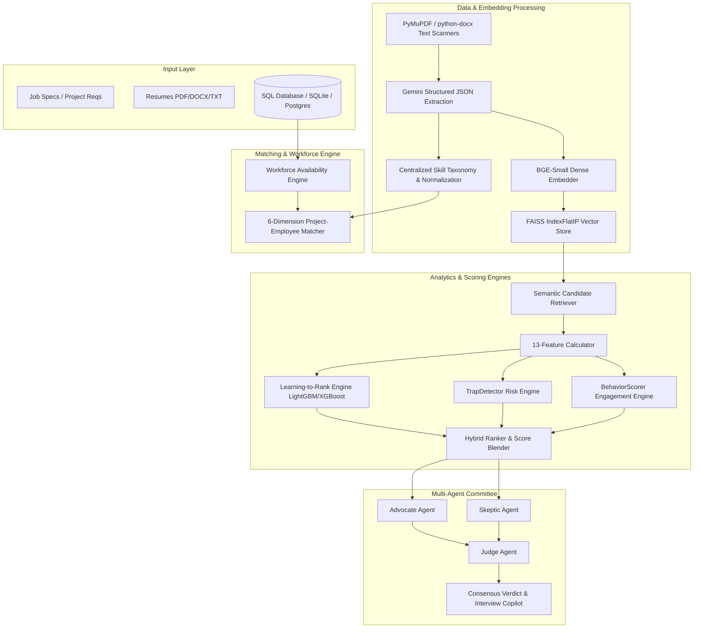

# TalentIQ - Enterprise AI Recruitment & Workforce Intelligence Platform

**TalentIQ** is an enterprise-grade AI-powered recruitment, candidate scoring, and project workforce matching platform. Built for high-volume hiring and talent allocation, TalentIQ combines **Learning-to-Rank (LTR) Machine Learning**, **Dense Vector Space Embeddings (BGE-Small + FAISS)**, a **6-Dimensional Transparent Skill Matching Engine**, a **100% Deterministic Workforce Availability Engine**, a **Multi-Signal Risk & Trap Detection Engine**, and an **Autonomous Multi-Agent Hiring Committee Simulation**.

---

## Technical Stack & Architecture



### Core Architecture Components
- **Backend API**: FastAPI (Async Handlers), SQLAlchemy ORM (PostgreSQL / SQLite dual-mode support).
- **Frontend Client**: React 18, Vite, TypeScript, Tailwind CSS, Recharts visualization library.
- **Machine Learning & Ranking**: LightGBM (`LGBMRanker`), XGBoost (`XGBRanker`), Scikit-Learn (`RandomForestRegressor`).
- **Dense Vector Search**: `BAAI/bge-small-en-v1.5` dense embeddings locally indexed using **FAISS-CPU** (`IndexFlatIP`).
- **LLM Integration**: Google Gemini 2.5 Flash via structured JSON API protocols.

---

## Exhaustive Algorithmic Catalog

TalentIQ operates on ten modular algorithmic systems. Below is the complete mathematical, statistical, and logical specification of every algorithm implemented in the codebase.

---

### 1. Learning-to-Rank (LTR) & Hybrid Ranking Engine
*Implementation Location: [`backend/ranking/hybrid_ranker.py`](file:///c:/Users/nithi/OneDrive/Desktop/REC/Projects/Final_Year_Project/TalentIQ/backend/ranking/hybrid_ranker.py), [`backend/learning_to_rank/ltr_model.py`](file:///c:/Users/nithi/OneDrive/Desktop/REC/Projects/Final_Year_Project/TalentIQ/backend/learning_to_rank/ltr_model.py)*

The ranking system transforms candidate profiles into multi-dimensional feature representations, predicts candidate relevance using Gradient Boosted Decision Trees, and blends machine learning inference with human-tuned domain heuristics.

#### A. Learning-to-Rank Algorithms
The system implements a tiered model hierarchy:
1. **Primary Model — LambdaMART (`lightgbm.LGBMRanker`)**:
   Uses gradient boosted decision trees optimizing **LambdaMART** (LambdaRank objective with Normalized Discounted Cumulative Gain metric optimization).
   $$\text{Objective} = \text{lambdarank}, \quad \text{Metric} = \text{NDCG@k}$$
2. **Secondary Model — Gradient Boosted Ranking (`xgboost.XGBRanker`)**:
   Uses XGBoost pairwise ranking with `rank:ndcg` objective.
3. **Tertiary Model — Scikit-Learn Random Forest Regressor (`sklearn.ensemble.RandomForestRegressor`)**:
   Fallback regression tree ensemble when ranking libraries are unavailable.
4. **Offline Evaluation Metric — NDCG@100**:
   Measures ranking quality compared to ideal ordering:
   $$\text{DCG}@k = \sum_{i=1}^{k} \frac{2^{rel_i} - 1}{\log_2(i + 1)}, \qquad \text{NDCG}@k = \frac{\text{DCG}@k}{\text{IDCG}@k}$$

#### B. Min-Max Normalization
Predicted LTR raw scores are dynamically normalized to a $[0, 100]$ scale across retrieved candidates:
$$S_{norm} = \begin{cases} \left( \frac{S_{raw} - S_{min}}{S_{max} - S_{min}} \right) \times 100, & \text{if } S_{max} - S_{min} > 0 \\ 50.0, & \text{otherwise} \end{cases}$$

#### C. Manual Heuristic Scoring Formula
Hand-crafted domain weights provide baseline candidate evaluation:
$$Score_{Manual} = \sum_{i=1}^{n} w_i \cdot x_i$$
where weights $w_i$ sum to $1.0$:
- Skill Match Score ($25\%$)
- Dense Embedding Similarity ($20\%$)
- Work Experience Score ($15\%$)
- Career Progression Score ($10\%$)
- Behavioral Score ($10\%$)
- Industry Alignment ($5\%$)
- Education Tier ($5\%$)
- Leadership Score ($4\%$)
- Certification Score ($3\%$)
- Past Company Quality ($3\%$)

#### D. Blended Score Formula & Risk Penalty Deduction
The final candidate rank score blends LTR prediction ($80\%$) and Manual Heuristic ($20\%$), minus risk deductions:
$$Score_{Blended} = 0.80 \times Score_{LTR} + 0.20 \times Score_{Manual}$$
$$Penalty_{Risk} = \left( \frac{Score_{Risk}}{100} \right) \times 30.0$$
$$Score_{Final} = \max\left(0.0, \, \min\left(100.0, \, Score_{Blended} - Penalty_{Risk}\right)\right)$$

#### E. Strict Tie-Breaking Sorting Algorithm
To guarantee 100% deterministic ranking across execution runs, candidates are sorted using a tuple key:
$$\text{SortKey}(c) = \left( -Score_{Final}(c), \; \text{CandidateID}(c) \right)$$

---

### 2. Dense Vector Embeddings & Vector Search Indexing
*Implementation Location: [`backend/embeddings/vector_store.py`](file:///c:/Users/nithi/OneDrive/Desktop/REC/Projects/Final_Year_Project/TalentIQ/backend/embeddings/vector_store.py), [`backend/faiss/index_manager.py`](file:///c:/Users/nithi/OneDrive/Desktop/REC/Projects/Final_Year_Project/TalentIQ/backend/faiss/index_manager.py)*

Semantic retrieval models text into high-dimensional vector space so recruiters can search by role concept rather than strict string matches.

#### A. Dense Embedding Generation
- **Primary Model**: `BAAI/bge-small-en-v1.5` via `sentence-transformers`.
- **Vector Dimension**: $D = 384$.
- **L2 Vector Normalization**:
  $$\hat{\mathbf{v}} = \frac{\mathbf{v}}{\|\mathbf{v}\|_2} = \frac{\mathbf{v}}{\sqrt{\sum_{i=1}^{384} v_i^2}}$$

#### B. FAISS Inner Product Index (`IndexFlatIP`)
Because embeddings are $L_2$-normalized ($\|\hat{\mathbf{u}}\|_2 = 1, \|\hat{\mathbf{v}}\|_2 = 1$), the Inner Product (Dot Product) equals Cosine Similarity:
$$\langle \hat{\mathbf{u}}, \hat{\mathbf{v}} \rangle = \sum_{i=1}^{384} \hat{u}_i \hat{v}_i = \cos(\theta)$$
Search complexity is $O(N \cdot D)$ using FAISS CPU acceleration.

#### C. NumPy Cosine Similarity Matrix Fallback
If FAISS is missing, pure NumPy computes pairwise cosine similarity:
$$\text{Similarity}(\mathbf{q}, \mathbf{d}_i) = \frac{\mathbf{q} \cdot \mathbf{d}_i}{\|\mathbf{q}\|_2 \|\mathbf{d}_i\|_2}$$

#### D. Pseudo-Embedding ASCII Character Frequency Fallback
If transformer libraries are offline, a deterministic character-frequency hashing vector ensures service continuity:
$$v_k = \sum_{\{c \in \text{text} \mid \text{index}(c) \equiv k \pmod{D}\}} \text{ord}(c), \qquad \hat{\mathbf{v}} = \frac{\mathbf{v}}{\|\mathbf{v}\|_2}$$

---

### 3. Risk Engine & Profile Trap Detection (`TrapDetector`)
*Implementation Location: [`backend/risk_engine/trap_detector.py`](file:///c:/Users/nithi/OneDrive/Desktop/REC/Projects/Final_Year_Project/TalentIQ/backend/risk_engine/trap_detector.py)*

Scans profiles for resume padding, timeline inconsistencies, career anomalies, and honeypot traps.

```mermaid
flowchart LR
    Candidate Profile --> T1[1. Keyword Stuffing]
    Candidate Profile --> T2[2. Overlapping Tenures]
    Candidate Profile --> T3[3. Impossible Career Jump]
    Candidate Profile --> T4[4. Honeypot Inactivity]
    Candidate Profile --> T5[5. Consulting Trap]
    Candidate Profile --> T6[6. Title Chaser]
    Candidate Profile --> T7[7. Pure Academic]
    
    T1 & T2 & T3 & T4 & T5 & T6 & T7 --> Aggregate[Sum Risk Penalties]
    Aggregate --> Threshold{Risk Score >= 40?}
    Threshold -->|Yes| TrapFlag[Flagged as Profile Trap]
    Threshold -->|No| Verified[Profile Verified]
```

#### Trap Detection Algorithms:
1. **Keyword Stuffing / Skill Inflation Trap**:
   - Penalty: $+25.0$ if $|\text{Skills}| > 25$.
   - Penalty: $+20.0$ if $\text{Title} \in \text{SeniorKeywords}$ and $\text{YearsExperience} < 2.0$.
   - Penalty: $+30.0$ if $\text{Title} \in \text{NonTech}$ and $|\text{Skills} \cap \text{AdvancedML}| \ge 2$.

2. **Timeline Inconsistency & Overlapping Job Tenure Algorithm**:
   Evaluates date interval overlap across all past job pairs $(i, j)$:
   $$\text{Overlap}(i, j) = (\text{Start}_i \le \text{End}_j) \land (\text{Start}_j \le \text{End}_i)$$
   $$\text{OverlapDays} = \min(\text{End}_i, \text{End}_j) - \max(\text{Start}_i, \text{Start}_j)$$
   - Penalty: $+15.0 \times \text{Count}$ (capped at $+30.0$) if $\text{OverlapDays} > 90$.

3. **Impossible Career Progression Detector**:
   - Penalty: $+25.0$ if candidate moved from $\text{Intern/Junior}$ to $\text{Director/VP}$ in under $18 \text{ months}$.

4. **Honeypot Inactive Profile Alert Algorithm**:
   - Penalty: $+20.0$ if $\text{RecruiterResponseRate} < 0.15$ and $\text{DaysInactive} > 120$.

5. **Service Company / IT Consulting Firm Trap**:
   - Penalty: $+25.0$ if $100\%$ of employer career history consists of IT consulting service firms.

6. **Title Chaser Trap**:
   - Penalty: $+20.0$ if $\text{AverageTenureMonths} < 18.0$ across $\ge 2$ companies.

7. **Pure Academic / Research Trap**:
   - Penalty: $+20.0$ if candidate holds research/postdoc roles without production engineering experience.

#### Risk Classification Mapping:
$$\text{RiskLevel} = \begin{cases} \text{High}, & \text{if } Score_{Risk} \ge 60.0 \\ \text{Medium}, & \text{if } 30.0 \le Score_{Risk} < 60.0 \\ \text{Low}, & \text{if } Score_{Risk} < 30.0 \end{cases}, \qquad \text{is\_trap} = (Score_{Risk} \ge 40.0)$$

---

### 4. Behavioral Engine & Composite Engagement Index (`BehaviorScorer`)
*Implementation Location: [`backend/behavior_engine/behavior_scorer.py`](file:///c:/Users/nithi/OneDrive/Desktop/REC/Projects/Final_Year_Project/TalentIQ/backend/behavior_engine/behavior_scorer.py)*

Calculates a composite engagement score ($0-100$) based on platform activity signals:

$$\text{Score}_{Behavioral} = \frac{\sum_{k=1}^{9} w_k \cdot s_k}{\sum_{k=1}^{9} w_k} \times 100$$

| Signal ($k$) | Metric Evaluated | Weight ($w_k$) | Scoring Rule ($s_k$) |
|---|---|---|---|
| 1 | Profile Completeness | 10 | $\text{CompletenessScore} / 100 \times 10$ |
| 2 | Open-to-Work Flag | 10 | $10.0$ if True else $3.0$ |
| 3 | Recruiter Response Rate | 15 | $\text{ResponseRate} \times 15.0$ |
| 4 | Avg Response Time | 10 | $\le 2\text{h} \rightarrow 10$, $\le 12\text{h} \rightarrow 8$, $\le 24\text{h} \rightarrow 5$, $>24\text{h} \rightarrow 1$ |
| 5 | Activity Latency | 15 | $\le 7\text{d} \rightarrow 15$, $\le 30\text{d} \rightarrow 12$, $\le 90\text{d} \rightarrow 7$, $\le 180\text{d} \rightarrow 3$, $>180\text{d} \rightarrow 0$ |
| 6 | Notice Period | 10 | $\le 15\text{d} \rightarrow 10$, $\le 30\text{d} \rightarrow 8$, $\le 60\text{d} \rightarrow 4$, $>60\text{d} \rightarrow 1$ |
| 7 | Platform Activity Sum | 10 | $\min\left(\frac{\text{Apps} + 0.1(\text{Views}) + 0.05(\text{Searches})}{20.0}, 1.0\right) \times 10$ |
| 8 | Identity Verification Trust | 10 | $3.0(\text{Email}) + 3.0(\text{Phone}) + 2.0(\text{LinkedIn}) + \min\left(\frac{\text{Conn}}{500}, 1.0\right) \times 2.0$ |
| 9 | Interview & Offer Acceptance | 10 | $(\text{InterviewCompletionRate} \times 5.0) + (\text{OfferAcceptanceRate} \times 5.0)$ |

---

### 5. Employee-Project Skill Matching Engine
*Implementation Location: [`backend/services/matching_service.py`](file:///c:/Users/nithi/OneDrive/Desktop/REC/Projects/Final_Year_Project/TalentIQ/backend/services/matching_service.py)*

Calculates transparent, non-black-box suitability scores between available employees and structured project requirements across **6 weighted dimensions**.

```
Overall Project Match Score (100%)
 ├── Skill Coverage Score (35%)       --> Priority Weighted Ratio (Critical=1.5, Req=1.0, Pref=0.7)
 ├── Proficiency Match Score (25%)   --> 4-Level Numeric Ratio (Emp Level / Req Level)
 ├── Experience Match Score (15%)    --> Skill Experience Ratio (Emp Yrs / Req Yrs)
 ├── Role Relevance Score (10%)      --> Designation Substring & Title Alignment
 ├── Domain Relevance Score (10%)    --> Industry & Past Project History Match
 └── Technology Stack Score (5%)     --> Required Tech Pool Overlap Percentage
```

#### 6-Dimensional Formulas:
1. **Priority-Weighted Skill Coverage Score ($35\%$)**:
   Each required skill $r$ receives a priority weight:
   $$w(r) = \begin{cases} 1.5, & \text{if Priority} = \text{Critical} \\ 1.0, & \text{if Priority} = \text{Required} \\ 0.7, & \text{if Priority} = \text{Preferred} \end{cases}$$
   $$\text{CoverageScore} = \left( \frac{\sum_{r \in \text{Matched}} w(r)}{\sum_{r \in \text{AllReqs}} w(r)} \right) \times 100$$
   Matching stages evaluate 4 fallback tiers: (1) Canonical ID, (2) Normalized Name, (3) Alias Match, (4) Cosine Semantic Match ($\ge 0.85$ guard).

2. **4-Level Numeric Proficiency Match Score ($25\%$)**:
   Maps string labels to numeric scale: $\text{Beginner}=1, \text{Intermediate}=2, \text{Advanced}=3, \text{Expert}=4$.
   $$\text{ProficiencySatisfaction}(r) = \begin{cases} 1.0, & \text{if } L_{emp} \ge L_{req} \\ \max\left(0.25, \; \frac{L_{emp}}{L_{req}}\right), & \text{if } L_{emp} < L_{req} \end{cases}$$
   $$\text{ProficiencyScore} = \left( \frac{\sum_{r \in \text{Matched}} \text{ProficiencySatisfaction}(r) \cdot w(r)}{\sum_{r \in \text{AllReqs}} w(r)} \right) \times 100$$

3. **Skill Experience Match Score ($15\%$)**:
   $$\text{ExpSatisfaction}(r) = \begin{cases} 1.0, & \text{if } Y_{req} \le 0 \text{ or } Y_{emp} \ge Y_{req} \\ \max\left(0.3, \; \frac{Y_{emp}}{Y_{req}}\right), & \text{if } Y_{emp} < Y_{req} \end{cases}$$

4. **Role & Designation Relevance Score ($10\%$)**:
   Matches employee designation against project role title ($100\%$ exact match, $80\%$ technical generic, $60\%$ default).

5. **Domain & Industry Alignment Score ($10\%$)**:
   Evaluates project domain against candidate past project history and domain tags ($100\%$ exact match, $85\%$ partial substring, $50\%$ unaligned).

6. **Technology Stack Alignment Score ($5\%$)**:
   $$\text{TechScore} = \left( \frac{|\text{ProjectTechs} \cap \text{EmployeeTechPool}|}{|\text{ProjectTechs}|} \right) \times 100$$

#### Overall Match Score Formula:
$$Score_{Match} = 0.35 S_{cov} + 0.25 S_{prof} + 0.15 S_{exp} + 0.10 S_{role} + 0.10 S_{dom} + 0.05 S_{tech}$$

---

### 6. Workforce Availability Engine
*Implementation Location: [`backend/services/availability_service.py`](file:///c:/Users/nithi/OneDrive/Desktop/REC/Projects/Final_Year_Project/TalentIQ/backend/services/availability_service.py)*

Provides 100% deterministic workforce availability evaluation. **NO AI/LLMs are used.**

#### Availability Evaluation Rules:
1. **Inactive Workforce Exclusion Gate**:
   If $\text{Status} = \text{"Inactive"}$, employee is immediately marked `Unavailable`.

2. **Available-From Date Constraint**:
   If $\text{AvailableFrom} > \text{ProjectStartDate}$, employee is marked `Unavailable`.

3. **Date Interval Overlap Check**:
   Evaluates overlap between candidate assignments $[\text{Start}_{asn}, \text{End}_{asn}]$ and requested project period $[\text{Start}_{proj}, \text{End}_{proj}]$:
   $$\text{HasOverlap} = (\text{Start}_{asn} \le \text{End}_{proj}) \land (\text{End}_{asn} \ge \text{Start}_{proj})$$
   - **Same-Day Boundary Rule**: If $\text{End}_{asn} == \text{Start}_{proj}$, overlap is True (same-day handoffs prohibited to prevent double-booking).

---

### 7. Multi-Agent Hiring Committee Simulation
*Implementation Location: [`backend/agents/advocate_agent.py`](file:///c:/Users/nithi/OneDrive/Desktop/REC/Projects/Final_Year_Project/TalentIQ/backend/agents/advocate_agent.py), [`backend/agents/skeptic_agent.py`](file:///c:/Users/nithi/OneDrive/Desktop/REC/Projects/Final_Year_Project/TalentIQ/backend/agents/skeptic_agent.py), [`backend/agents/judge_agent.py`](file:///c:/Users/nithi/OneDrive/Desktop/REC/Projects/Final_Year_Project/TalentIQ/backend/agents/judge_agent.py), [`backend/agents/interview_agent.py`](file:///c:/Users/nithi/OneDrive/Desktop/REC/Projects/Final_Year_Project/TalentIQ/backend/agents/interview_agent.py)*

Simulates an executive hiring committee debate using three specialized LLM agents:

```
[Candidate Profile JSON + JD JSON]
        │
        ├───> Advocate Agent (Maximizes Strengths & Projects)
        │
        ├───> Skeptic Agent  (Audits Gaps, Risks & Short Tenures)
        │
        ▼
   Judge Agent (Synthesizes Briefs & Computes Consensus)
        │
        ├──> Final Recommendation Verdict: [Strong Hire | Hire | Borderline | No Hire]
        ├──> Consensus Confidence Score: [0 - 100%]
        └──> Interview Copilot (Difficulty-Tagged Targeted Questions)
```

1. **Advocate Agent Algorithm**: LLM agent prompting instructed to act as a candidate champion, extracting technical achievements, project complexities, and growth trajectory.
2. **Skeptic Agent Algorithm**: LLM agent prompting instructed to act as a strict risk auditor, finding missing requirements, unverified claims, and job-hopping patterns.
3. **Judge Consensus Agent Algorithm**: Synthesizes Advocate and Skeptic briefs into a consensus verdict (`Strong Hire`, `Hire`, `Borderline`, `No Hire`) and a numeric confidence score ($0-100$).
4. **Interview Copilot Algorithm**: Analyzes candidate skill gaps and generates tailored interview questions classified into difficulty tiers (`Easy`, `Medium`, `Hard`) across Technical, System Design, Coding, and Behavioral tracks.

---

### 8. Centralized Skill Taxonomy & Normalization Engine
*Implementation Location: [`backend/parsers/skill_normalizer.py`](file:///c:/Users/nithi/OneDrive/Desktop/REC/Projects/Final_Year_Project/TalentIQ/backend/parsers/skill_normalizer.py), [`backend/services/skill_service.py`](file:///c:/Users/nithi/OneDrive/Desktop/REC/Projects/Final_Year_Project/TalentIQ/backend/services/skill_service.py)*

Normalizes messy resume skill strings into standard canonical representations.

#### Normalization Pipeline:
1. **Dictionary Alias Lookup**: Direct mapping (`k8s` $\rightarrow$ `Kubernetes`, `py` $\rightarrow$ `Python`, `reactjs` $\rightarrow$ `React`).
2. **Regex Suffix Stripping**:
   $$\text{Pattern} = \text{r"\textbackslash s+(programming|development|developer|framework|library|lib|sdk|tool|tools)\$}$$
3. **Multi-Tier Database Taxonomy Resolution**:
   - Tier 1: Search DB by `normalized_name`.
   - Tier 2: Search DB by canonical `name` (case-insensitive).
   - Tier 3: Search DB by `aliases` array.
   - Tier 4: Fallback to Title-Cased original string.

---

### 9. Candidate Feature Engineering Calculator
*Implementation Location: [`backend/feature_engineering/feature_calculator.py`](file:///c:/Users/nithi/OneDrive/Desktop/REC/Projects/Final_Year_Project/TalentIQ/backend/feature_engineering/feature_calculator.py)*

Engineers a **13-feature dense vector** for each candidate profile:

$$\mathbf{x}_{cand} = \begin{bmatrix}
x_{1} : \text{skill\_match\_score} \\
x_{2} : \text{embedding\_similarity} \\
x_{3} : \text{experience\_score} \\
x_{4} : \text{career\_progression\_score} \\
x_{5} : \text{industry\_match} \\
x_{6} : \text{education\_tier\_score} \\
x_{7} : \text{certification\_score} \\
x_{8} : \text{leadership\_score} \\
x_{9} : \text{company\_quality} \\
x_{10} : \text{role\_similarity} \\
x_{11} : \text{technical\_depth} \\
x_{12} : \text{open\_source\_score} \\
x_{13} : \text{behavioral\_score}
\end{bmatrix}$$

---

### 10. Document Extraction & Structure Processing
*Implementation Location: [`backend/parsers/doc_parser.py`](file:///c:/Users/nithi/OneDrive/Desktop/REC/Projects/Final_Year_Project/TalentIQ/backend/parsers/doc_parser.py), [`backend/agents/candidate_agent.py`](file:///c:/Users/nithi/OneDrive/Desktop/REC/Projects/Final_Year_Project/TalentIQ/backend/agents/candidate_agent.py), [`backend/agents/jd_agent.py`](file:///c:/Users/nithi/OneDrive/Desktop/REC/Projects/Final_Year_Project/TalentIQ/backend/agents/jd_agent.py)*

1. **Document Text Parsing**:
   - PDF Documents: Extracted via PyMuPDF (`fitz`), preserving text block ordering and line breaks.
   - Word Documents: Extracted via `python-docx` iterating through paragraph and table flowables.
2. **LLM Schema Extraction**:
   Raw text is processed by Gemini using Pydantic/JSON schema extraction prompts to yield structured candidate profiles and job criteria JSON objects.

---

## Local Setup & Configuration Guide

### Prerequisites
- Python 3.10+
- Node.js v18+
- Gemini API Key (obtainable from Google AI Studio)

---

### Backend Configuration

1. **Navigate to the backend directory**:
   ```bash
   cd backend
   ```

2. **Create and activate virtual environment**:
   - **Windows**:
     ```powershell
     python -m venv venv
     .\venv\Scripts\activate
     ```
   - **macOS/Linux**:
     ```bash
     python3 -m venv venv
     source venv/bin/activate
     ```

3. **Install dependencies**:
   ```bash
   pip install -r requirements.txt
   ```

4. **Configure environment variables in `backend/.env`**:
   ```env
   DATABASE_URL=sqlite:///./talent_iq.db
   GEMINI_API_KEY=your-gemini-api-key-here
   JWT_SECRET=talent-iq-super-secret-key
   ```

5. **Start the FastAPI backend server**:
   ```bash
   python main.py
   ```
   The API will bind to `http://127.0.0.1:8000` with interactive OpenAPI docs at `http://127.0.0.1:8000/docs`.

---

### Frontend Configuration

1. **Navigate to the frontend directory**:
   ```bash
   cd frontend
   ```

2. **Install npm dependencies**:
   ```bash
   npm install
   ```

3. **Launch Vite development server**:
   ```bash
   npm run dev
   ```
   The user interface will run at `http://localhost:5173`.

---

## Quick Testing & Walkthrough Guide

1. Open `http://localhost:5173` in your web browser.
2. Log in using default recruiter credentials:
   - **Email**: `admin@talent_iq.ai`
   - **Password**: `password123`
3. **Upload Job Spec**: Click **Upload JD** to upload a job specification PDF/DOCX or paste raw text criteria.
4. **Parse & Rank Resumes**: Select a Job Spec, upload candidate resumes, and watch real-time processing through text extraction, dense vector search, hybrid ranking, risk evaluation, and multi-agent debate.
5. **Inspect Candidate Dossier**: Click **Details** on any candidate to inspect their match breakdown radar chart, trap detector warnings, Advocate/Skeptic debate logs, and generated ReportLab PDF dossier.
6. **Project Skill Matching**: Navigate to **Project Matching** to run the 6-Dimensional Skill Matcher on available workforce members.
